<div align="center">
  
  
  <br />
  
  <br />
  
</div>

<p align="center">
  <a href="https://github.com/vijaydevx/avnexai">AVNEXAI</a> &nbsp;/&nbsp;
  <a href="https://github.com/vijaydevx/nexora">NEXORA</a> &nbsp;/&nbsp;
  <a href="https://github.com/vijaydevx/ROYBOT">ROYBOT</a> &nbsp;/&nbsp;
  <a href="https://github.com/vijaydevx/verto-platform">VERTO</a> &nbsp;/&nbsp;
  <a href="https://github.com/vijaydevx/Meetric">Meetric</a> &nbsp;/&nbsp;
  <a href="https://github.com/vijaydevx/C_Programming">C Programming</a>
</p>

## Build the profile graphics

The contribution graphics use live data for `vijaydevx`. To create the portrait outputs locally, install the image dependency, then run the scripts from the repository root:

```powershell
python -m pip install -r scripts/requirements-photo.txt
python scripts/prep_photo.py
python scripts/make_ascii_svg.py
```

Contribution data and cards are refreshed by the GitHub Actions workflow. To render them locally, install `scripts/requirements.txt`, then run `fetch_contributions.py`, `make_info_card.py`, `render_heatmap_svg.py`, and `render_monthly_stats.py` in that order.

The bundled fonts in `fonts/` are used in the generated identity card and are licensed under the SIL Open Font License 1.1.

